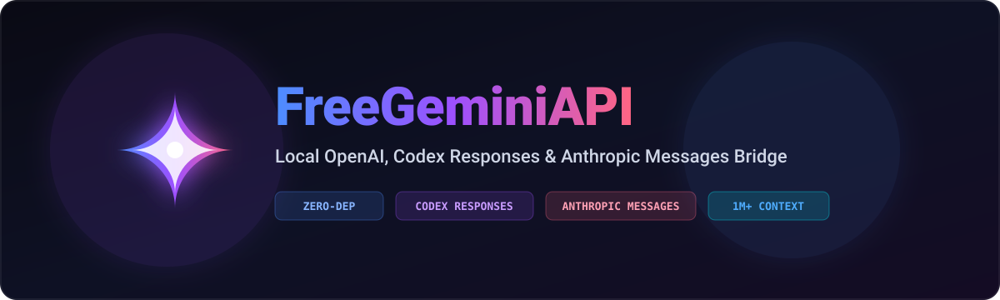

<p align="center">
  
</p>

<p align="center">
  <strong>Локальный шлюз к веб-версии Google Gemini с поддержкой OpenAI, Codex Responses и Anthropic Messages API</strong><br>
  <em>Бесплатный доступ ко всей линейке моделей Gemini (включая Gemini Advanced / Argon, Gemini Hydrogen, 2.0 Flash Thinking, 2.0 Pro Experimental) через стандартные протоколы с сохранением всех возможностей вашей подписки.</em>
</p>

<p align="center">
  
  
  
  
  
</p>

---

## ⚡ О проекте

**FreeGeminiAPI** превращает сессию веб-интерфейса Google Gemini в универсальный локальный API-сервер.

Если у вас есть подписка **Google One AI Premium (Gemini Advanced)** или стандартный Google-аккаунт, прокси позволяет использовать веб-модели напрямую в любимых инструментах разработчика — **Codex CLI**, **Claude Code**, **Cline / Roo Code**, **Cursor**, **Aider**, **Open WebUI** — без биллинга Google Cloud / AI Studio и без урезанных квот.

### Ключевые особенности
- 🚀 **Zero Dependencies**: чистый Node.js 18+ без внешних npm-пакетов.
- ⚡ **OpenAI Responses API**: нативная поддержка протокола Responses (`/v1/responses`) для терминального агента **OpenAI Codex CLI (`codex`)**.
-  Claude **Anthropic Messages API**: полная эмуляция протокола Claude (`/v1/messages`), включая стриминг блоков рассуждений (`thinking_delta`) для **Claude Code** и **Cline**.
- 💬 **OpenAI Chat Completions**: стандартный эндпоинт (`/v1/chat/completions`) со стримингом токенов (SSE) для Cursor, Open WebUI и любых скриптов на `openai` SDK.
- 🎯 **Каталог моделей `/model` для Codex**: автоматическая генерация манифеста моделей для интерактивного меню с окном контекста 1,000,000 токенов и уровнями reasoning.
- 🔑 **Авто-логин в любом браузере**: скрипт автоматически находит **Firefox** (через протокол WebDriver BiDi) или **Chromium / Chrome / Brave** (через CDP) и перехватывает сессию при первом запуске.
- 🛠️ **CLI-лаунчер `freegemini`**: быстрое управление процессом в терминале (`freegemini bg`, `status`, `logs`, `stop`).

---

## 🧠 Поддерживаемые модели

| Модель | Назначение | Режим | Окно контекста |
|---|---|---|---|
| `gemini-advanced` | **Gemini Advanced (Argon)** — флагманский кодинг, глубокий рефакторинг | Thinking + Pro | 1,048,576 |
| `gemini-hydrogen` *(алиас `hydrogen`)* | **Gemini Hydrogen** — ультра-низкая задержка (TTFT), максимальная скорость | Fast | 1,048,576 |
| `gemini-2.0-flash-thinking` | **Gemini 2.0 Flash Thinking** — быстрые пошаговые рассуждения | Reasoning | 1,048,576 |
| `gemini-2.0-pro-exp` | **Gemini 2.0 Pro Experimental** — сложные алгоритмы, глубокая логика | Deep Reasoning | 1,048,576 |
| `gemini-2.0-flash` | **Gemini 2.0 Flash** — стандартная модель нового поколения (по умолчанию) | Standard | 1,048,576 |
| `gemini-1.5-pro` | **Gemini 1.5 Pro** — стабильный тяжелый контекст | High Context | 1,048,576 |
| `gemini-1.5-flash` | **Gemini 1.5 Flash** — легкая базовая модель | Fast | 1,048,576 |
| `claude-3-7-sonnet` | Алиас под Claude Code, маршрутизируется в `gemini-advanced` | Thinking | 1,048,576 |
| `claude-3-5-sonnet` | Алиас под Claude Code, маршрутизируется в `gemini-advanced` | Thinking | 1,048,576 |
| `claude-3-5-haiku` | Алиас под Claude Code, маршрутизируется в `gemini-hydrogen` | Fast | 1,048,576 |
| `claude-3-opus` | Алиас под Claude Code, маршрутизируется в `gemini-advanced` | Deep Reasoning | 1,048,576 |

---

## 🚀 Быстрый старт

### 1. Клонирование
```bash
git clone https://github.com/your-username/FreeGeminiAPI.git
cd FreeGeminiAPI
```

### 2. Первый запуск и авторизация
При первом запуске скрипт автоматически обнаружит браузер (**Firefox** или **Chromium / Chrome**) и откроет страницу авторизации:
```bash
npm start
```
1. Войдите в свой Google-аккаунт в открывшемся окне.
2. Сервер автоматически перехватит куки и токен `SNlM0e`, закроет окно и сразу запустит API на `http://127.0.0.1:9656/v1`.

*Для принудительного выбора браузера:*
```bash
BROWSER=firefox npm run auth     # использовать Firefox
BROWSER=chromium npm run auth    # использовать Chromium/Chrome
```

---

## 🕹️ Удобный CLI-лаунчер `freegemini`

Установите глобальный шорткат в систему:
```bash
./scripts/freegemini.sh install
```

Команды из любого терминала:
- `freegemini` — запуск на переднем плане с живыми логами запросов
- `freegemini bg` — запуск в фоне (процесс отвязывается от терминала)
- `freegemini status` — проверка состояния сервера и списка моделей
- `freegemini logs` — чтение фоновых логов в реальном времени (`tail -f`)
- `freegemini stop` — аккуратная остановка фонового сервера

---

## 🔌 Подключение к инструментам

### 1. OpenAI Codex CLI (`codex`)

Codex CLI работает через нативный протокол Responses API.

#### Настройка в 1 команду:
```bash
npm run setup:codex
```
Команда сгенерирует `~/.codex/models.json` с контекстом 1M токенов и обновит `~/.codex/config.toml`.

#### Ручной конфиг (`~/.codex/config.toml`):
```toml
approval_policy = "on-request"
sandbox_mode = "workspace-write"

model_provider = "gemini"
model = "gemini-advanced"
model_catalog_json = "/home/USERNAME/.codex/models.json"

[model_providers.gemini]
name = "gemini"
base_url = "http://127.0.0.1:9656/v1"
wire_api = "responses"
supports_websockets = false
```

Проверка:
```bash
codex exec --skip-git-repo-check "Ответь одним словом: работает?"
```
В интерактивном TUI по нажатию `/model` доступен полный список всех моделей линейки.

---

### 2. Claude Code CLI (`claude`)

FreeGeminiAPI поддерживает нативный протокол Anthropic Messages API (`/v1/messages`).

В `~/.bashrc` или `~/.zshrc`:
```bash
export ANTHROPIC_BASE_URL="http://127.0.0.1:9656"
export ANTHROPIC_API_KEY="not-needed"
```

Запуск:
```bash
claude
```
Запросы на `claude-3-7-sonnet` автоматически транслируются в `gemini-advanced` с поддержкой reasoning.

---

### 3. Cline / Roo Code / Cursor / Aider / Open WebUI

- **Base URL:** `http://127.0.0.1:9656/v1`
- **API Key:** любое значение (`dummy`)
- **Модель:** `gemini-advanced`, `gemini-hydrogen` или `gemini-2.0-flash-thinking`

#### Python-пример:
```python
from openai import OpenAI

client = OpenAI(
    base_url="http://127.0.0.1:9656/v1",
    api_key="not-needed"
)

response = client.chat.completions.create(
    model="gemini-hydrogen",
    messages=[{"role": "user", "content": "Привет! Назови три закона робототехники."}]
)

print(response.choices[0].message.content)
```

---

## 🏗️ Архитектура

```
┌────────────────────────────────────────────────────────┐
│  Клиенты: Codex CLI / Claude Code / Cursor / Aider     │
└───────────────────────────┬────────────────────────────┘
                            │
     ┌──────────────────────┼──────────────────────┐
     │ /v1/responses        │ /v1/messages         │ /v1/chat/completions
     ▼                      ▼                      ▼
┌────────────────────────────────────────────────────────┐
│               FreeGeminiAPI Server (:9656)             │
│  - Zero-dependency Node.js HTTP Server                 │
│  - Multi-protocol normalizer (OpenAI / Claude / Codex) │
│  - Line-delimited stream parser                        │
│  - Multi-turn session continuity manager               │
└───────────────────────────┬────────────────────────────┘
                            │ Batchexecute RPC (StreamGenerate)
                            │ Cookie: __Secure-1PSID; at: SNlM0e
                            ▼
┌────────────────────────────────────────────────────────┐
│          Google Gemini Web Frontend (GFE / Bard)       │
│  https://gemini.google.com/_/BardChatUi/data/...       │
└───────────────────────────┬────────────────────────────┘
```

1. **Batchexecute RPC**: прокси упаковывает запросы в JSPB-массив (`f.req`) и подписывает сессионным токеном `at`.
2. **Stream Parser**: потоковые ответы Google декодируются построчно налету с извлечением текста, блоков рассуждений и сессионных ID.
3. **Session Tracking**: прокси сохраняет тройку `[cid, rid, rcid]` для непрерывности multi-turn диалогов.

---

## ⚙️ Системная служба systemd (Linux)

Создайте `~/.config/systemd/user/free-gemini-api.service`:

```ini
[Unit]
Description=FreeGeminiAPI Proxy Server
After=network.target

[Service]
Type=simple
WorkingDirectory=%h/.gemini/antigravity/scratch/FreeGeminiAPI
ExecStart=/usr/bin/node server.js
Restart=always
RestartSec=5
Environment=PORT=9656
Environment=HOST=127.0.0.1

[Install]
WantedBy=default.target
```

Активация:
```bash
systemctl --user daemon-reload
systemctl --user enable --now free-gemini-api
```

---

## 🔒 Безопасность

Файл `gemini-auth.json`, профили браузеров и логи добавлены в `.gitignore`. При публикации в GitHub ваши персональные токены никогда не попадут в репозиторий. Прокси слушает исключительно локальный адрес `127.0.0.1`.
